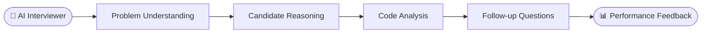

<div align="center">


<a href="https://github.com/adyujjwal">
  
</a>

<br/>

<a href="https://www.linkedin.com/in/adwayujjwal"></a>
<a href="https://adwayujjwal.netlify.app"></a>
<a href="https://github.com/adyujjwal"></a>
<a href="mailto:adway.ujjwal@outlook.com"></a>

<br/><br/>


</div>

<br/>


## 👋 About Me

<table>
<tr>
<td width="62%">

I'm a **Senior Software Engineer at Walmart Global Tech**, focused on building **scalable, reliable and user-centric software**.

I work across the stack — from **backend services and distributed systems** to **intuitive frontend experiences** — and I'm increasingly exploring how **Generative AI and AI Agents** can make software smarter.

> *Building software is easy. Building software that scales, survives production, and stays understandable six months later is the fun part.*

</td>
<td width="38%">

```text
💼 Role      → Senior SWE
🏢 Company   → Walmart Global Tech
🧑‍💻 Stack     → Java • Spring • React
☁️ Cloud     → AWS • K8s • Docker
🤖 AI        → LLMs • RAG • LangGraph
📍 Location  → Bengaluru, India
```

</td>
</tr>
</table>


## 🏢 Where I've Worked

<div align="center">

<table>
<tr>
<td align="center" width="33%">
<a href="https://corporate.walmart.com/"></a>
<br/><br/>
<b>Walmart Global Tech</b><br/>
<sub>Senior Software Engineer</sub>
</td>
<td align="center" width="33%">
<a href="https://www.sap.com/india/"></a>
<br/><br/>
<b>SAP Labs India · SAP Concur</b><br/>
<sub>Software Engineer</sub>
</td>
<td align="center" width="33%">
<a href="https://www.enquero.com/"></a>
<br/><br/>
<b>Enquero</b><br/>
<sub>Software Engineer</sub>
</td>
</tr>
</table>

</div>


## 🚀 What I Work On

<table>
<tr>
<td width="33%" valign="top">

### 🏗️ Backend & Distributed Systems

- Java & Spring Boot microservices
- REST APIs & event-driven systems
- Database design, caching, concurrency
- Cloud-native architectures
- Reliability, scalability, observability

</td>
<td width="33%" valign="top">

### 🎨 Full Stack Engineering

- Production apps with **React**
- Reusable UI components & architectures
- Frontend ↔ microservice integration
- Modernizing legacy applications
- Better user experiences

</td>
<td width="33%" valign="top">

### 🤖 AI Engineering

- LLM-powered applications
- RAG pipelines & vector databases
- AI Agents & agentic workflows
- LangChain · LangGraph · tool calling
- AI-powered developer tools

</td>
</tr>
</table>


## 🧰 Tech Stack

<div align="center">

<br/>


<br/><br/>


</div>


## 🏆 Recognition

<div align="center">

<table>
<tr>
<td align="center" width="50%">


**Virtra** — a metaverse-based hotel booking experience

<br/>
<sub>Unity · React 360 · Interactive 3D</sub>

</td>
<td align="center" width="50%">


**AR-powered walkthrough & support experience** for product onboarding and troubleshooting

<sub>Augmented Reality · Developer Experience</sub>

</td>
</tr>
</table>

🎓 **Mentoring & Knowledge Sharing** — mentored engineers and students · published technical articles · contributed to internal engineering communities

</div>


## 🔬 Things I'm Building

### 🤖 AI Interview Platform

An AI-powered mock interview platform that simulates realistic technical interviews.




## 📊 GitHub Stats

<div align="center">


<br/>


<br/>


<br/>


</div>


## 📈 Currently Learning

<div align="center">


<sub><i>There's always another abstraction to understand.</i></sub>

</div>


<div align="center">
<picture>
  <source media="(prefers-color-scheme: dark)" srcset="https://raw.githubusercontent.com/adyujjwal/adyujjwal/output/github-snake-dark.svg" />
  
</picture>
</div>


<br/>

<div align="center">

### ☕ Code. Learn. Build. Repeat.

*"Good engineers write code. Great engineers build systems."*


</div>
